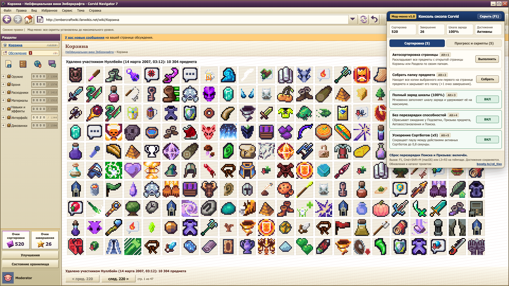
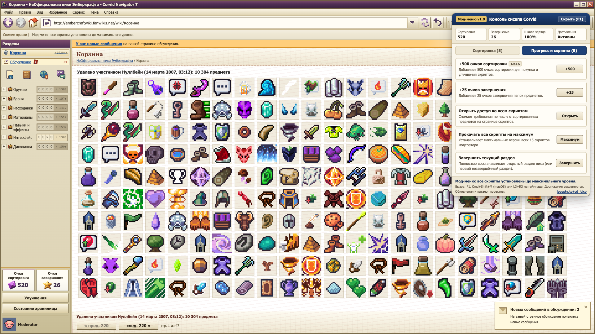

# Deleted Wiki: Clean Up the Lost Files · Мод-меню

Внутриигровое меню на русском языке с десятью функциями для автосортировки каталога, шкалы заряда, СортБотов и прокачки 15 скриптов.

**[Скачать мод-меню v1.0 (ZIP)](https://github.com/neoru-droid/deleted-wiki-trainer-ru/releases/download/v1.0.0/DeletedWiki-Trainer-RU-v1.0.zip)** · [Как установить](#установка)

Проверено на версии 1.0.24 (сборка Steam 26304123) для Windows (`F1`, `Alt+1..6`), Steam Deck / Linux (`install-steamdeck.sh`, `L3 + R3`) и macOS (`install-macos.command`, `Cmd + Shift + M`). Достижения Steam работают в штатном режиме, а в соревновательных забегах на время («Спринт» и «Уборка») функции автоматически отключены для защиты таблиц лидеров.

Начисленные очки сортировки и завершения, прокачанные скрипты и разложенные по папкам предметы остаются в сохранении после удаления мод-меню.

## Установка

1. **Windows:** закройте игру, распакуйте архив и запустите `DeletedWiki-Trainer-Setup.exe` -> **«Установить мод-меню»** (при окне SmartScreen: «Подробнее» -> «Выполнить в любом случае»).
2. **Steam Deck / Linux:** распакуйте все файлы архива в одну папку и запустите `sh install-steamdeck.sh` рядом с `DeletedWiki-Trainer-Setup.exe`.
3. **macOS:** распакуйте файлы архива в одну папку и запустите `install-macos.command` в Finder.
4. **Удаление:** запустите установщик повторно и нажмите **«Удалить мод-меню»**. Полностью совместимо как с оригинальной английской игрой, так и с [русификатором текста](https://github.com/neoru-droid/deleted-wiki-ru) - оба пакета хранят резервные копии раздельно (`trainer_backup_orig` и `ru_backup_orig`) и удаляются независимо в любом порядке.

## Возможности (10 функций)

### Вкладка «Сортировка»
1. **Автосортировка страницы** (`Alt+1`) - раскладывает все предметы с открытой страницы Корзины или Раздела по своим папкам (в архиве Нуллбейна отправляет записи в Корзину).
2. **Собрать папку предмета** (`Alt+2`) - находит все копии выбранного или первого на странице предмета и закрывает его папку (`+1` очко завершения).
3. **Полный заряд шкалы (100%)** (`Alt+3`) - мгновенно заполняет шкалу заряда и удерживает её на максимуме.
4. **Без перезарядки способностей** (`Alt+4`) - сбрасывает ожидание у Подсветки, Призыва предмета, Автовосстановления и Поиска.
5. **Ускорение СортБотов (x5)** (`Alt+5`) - сокращает интервал между действиями активных СортБотов до `0.8` сек.

### Вкладка «Прогресс и скрипты»
6. **+500 очков сортировки** (`Alt+6`) - добавляет 500 очков сортировки для покупки и улучшения скриптов.
7. **+25 очков завершения** - добавляет 25 очков завершения папок предметов.
8. **Открыть доступ ко всем скриптам** - снимает пороги по числу отсортированных предметов на странице скриптов.
9. **Прокачать все скрипты на максимум** - устанавливает максимальные версии всех 15 скриптов модератора.
10. **Завершить текущий раздел** - полностью восстанавливает открытый раздел вики (или первый незавершённый раздел).

*При каждом новом запуске игры переключатели выключены по умолчанию.*

## Управление

- **Открыть / скрыть меню:**
  - Windows и Linux: `F1`
  - macOS: `F1` или `Cmd + Shift + M`
  - Геймпад и Steam Deck: одновременное нажатие стиков `L3 + R3`
- **Быстрые клавиши:** `Alt + 1` .. `Alt + 6` (работают без сворачивания игры).

## Как выглядит меню

**Вкладка «Сортировка»**

**Вкладка «Прогресс и скрипты»**

**Прокачанные скрипты и очки в игре**

## Обратная связь и ссылки

Об ошибке можно написать в [Issues](https://github.com/neoru-droid/deleted-wiki-trainer-ru/issues).

[Все версии](https://github.com/neoru-droid/deleted-wiki-trainer-ru/releases) · [Русификатор Deleted Wiki](https://github.com/neoru-droid/deleted-wiki-ru) · [Boosty](https://boosty.to/cd_tixo) · [Разовые чаевые](https://pay.cloudtips.ru/p/240b8760)
